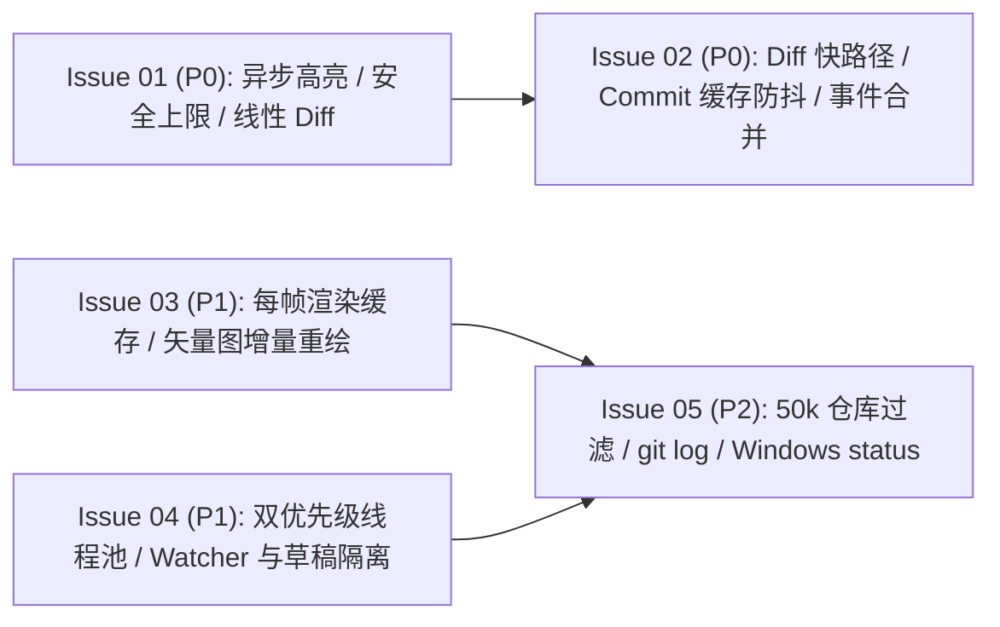

# Spec 10: Diff 切换延迟治理、每帧渲染缓存与大仓库性能优化规约

- **目录**：`.scratch/10-diff-switching-and-render-performance/`
- **下属 Issues**：
  - [`01-async-syntax-highlighting-and-safe-diff-limits.md`](./issues/01-async-syntax-highlighting-and-safe-diff-limits.md)（P0 · 异步语法高亮、大文件/长行安全护栏与线性 Diff 算法）
  - [`02-fast-diff-loading-commit-cache-and-event-coalescing.md`](./issues/02-fast-diff-loading-commit-cache-and-event-coalescing.md)（P0，Blocked by `01` · 极速 Diff 加载路径、Commit 工作台缓存防抖与事件合并）
  - [`03-render-hot-path-caching-and-vector-graph-perf.md`](./issues/03-render-hot-path-caching-and-vector-graph-perf.md)（P1 · 每帧渲染缓存、图谱缓存持久化与矢量图增量更新）
  - [`04-engine-worker-priority-and-watcher-isolation.md`](./issues/04-engine-worker-priority-and-watcher-isolation.md)（P1 · 引擎双优先级通道、Watcher 线程池隔离与草稿异步写盘）
  - [`05-large-repo-filtering-graph-and-status-scaling.md`](./issues/05-large-repo-filtering-graph-and-status-scaling.md)（P2，Blocked by `03, 04` · 大仓库日志过滤、`git log` 路径筛选、可达分支异步化与状态扫描扩展性）
- **关联源码**：
  - `Cargo.toml`
  - `crates/jbgit-core/src/details.rs`、`stage_tracker.rs`、`filter.rs`、`graph/edges_in_row.rs`
  - `crates/jbgit-engine/src/details.rs`、`stage.rs`、`pool.rs`、`supervisor.rs`、`watcher.rs`
  - `crates/jbgit-tui/src/main.rs`、`app.rs`、`app_stage.rs`、`syntax.rs`、`log_view.rs`、`stage_view.rs`、`input.rs`
  - `crates/jbgit-tui/src/keymap/mod.rs`、`keymap/resolve.rs`
  - `crates/jbgit-tui/src/graph/state.rs`、`graph/renderer.rs`、`graph/vector/mod.rs`、`graph/vector/encode.rs`
  - `crates/jbgit-tui/src/views/mod.rs`、`views/log.rs`、`views/log_details.rs`、`views/commit_diff.rs`、`views/footer.rs`

---

## 1. 背景与问题诊断

用户在日常使用中反馈：在切换不同代码修改时，界面存在明显延迟。经 `2026-11-21` 在本机使用 `tools/jbgit-pilot` 对 `target/debug/jbgit.exe`（dev）与 `target/release/jbgit.exe`（release）进行 `DEV / RELEASE × syntax_highlight 开 / 关` 2×2 对照实测，并对三个 Crate 做全链路代码审计后，确认卡顿由「Dev 模式无三方优化导致 `syntect` 放大 10–15 倍」与「19 项底层架构/算法瓶颈」共同造成。

### 1.1 实测基线数据（2026-11-21）

> 注：`jbgit-pilot` 单次按键+截屏链路存在约 **85–100 ms** 固定测试开销，因此测得 `80–115 ms` ≈ 实际体感瞬时（`< 20 ms`）。

**场景 A：Commit 工作台切换真实 Rust 文件修改**

| 切换动作 | DEV + 开高亮（默认） | DEV + 关高亮 | RELEASE + 开高亮 | RELEASE + 关高亮 |
|---|---:|---:|---:|---:|
| `+300 行` Rust (`b_details.rs`) | **374 ms** | 97 ms | 111 ms | 82 ms |
| `24 个 hunk` 切回 (`a_app.rs` 二次访问) | **456 ms** | 108 ms | 101 ms | 85 ms |
| `+1281 行` 新文件 (`d_new_1281.rs`) | **1,378 ms** | 109 ms | **188 ms** | 83 ms |
| `Context: Full`（2658 行 `a_app.rs`） | **6,315 ms** | 112 ms | **542 ms** | 83 ms |
| 单测：首次加载 `SyntaxSet` + 高亮 1 行 Rust | **270 ms** | — | **40 ms** | — |

**场景 B：Log 视图（本仓库 commit `204d06b`，41 文件 / +4432 行，切换 ~95 行 `.md` diff）**

- `DEV + 开高亮`：**325–665 ms** → `DEV + 关高亮`：**99–109 ms** → `RELEASE + 开高亮`：**110–136 ms**。

### 1.2 全代码库瓶颈审计汇总（19 项）

#### 一、Diff 切换与高亮主线程阻塞（P0 核心）
1. **Dev 态无依赖优化 + `syntect` `default-fancy` 回溯引擎**：`Cargo.toml` 第 35 行使用 `default-fancy`（`fancy-regex`）且未配置 `[profile.dev.package.*]`，dev 下 `opt-level = 0` 使语法高亮慢 10–15 倍。
2. **语法高亮同步阻塞 UI 主线程**：`HighlightedDiff::build`（`syntax.rs:84-113`）直接在 UI 线程执行——Commit 页位于事件响应 `StageFileDiffLoaded`（`app_stage.rs:881`）与渲染兜底（`views/commit_diff.rs:143`），Log 页位于 `FileDiffLoaded`（`app.rs:2320-2323`）与渲染兜底（`views/log_details.rs:485`）；同时 `SyntaxSet::load_defaults_newlines()` 首次懒加载也发生在 UI 线程；且对每个 `DiffLineKind::Context` 行同时驱动 `hl_old` 与 `hl_new` 双重高亮。
3. **单行无长度拦截与 `FileDiffLoaded` 过期 `epoch` 未过滤**：`syntax.rs:103-113` 未对单行字节长度做上限保护，超长压缩 JS/JSON/SVG 单行易引发 `fancy-regex` 灾难性回溯；`app.rs:2307-2340` 处理 `EngineEvent::FileDiffLoaded` 时未丢弃小于 `self.latest_file_diff_epoch` 的过期响应，仍同步运行 `HighlightedDiff::build`。
4. **Commit 工作台缺少 Diff/高亮 LRU 缓存与防抖**：`app_stage.rs:808-825` 与 `stage_view.rs:401-404` 仅保留当前一份 `current_diff` 与 `diff_syntax`，无 LRU 缓存也无切换防抖，反复切回同一文件必定重读三文档、重算 diff 与重跑高亮；`ThreeDocStageDiff::as_file_diff()`（`crates/jbgit-engine/src/stage.rs:49-61`）深拷贝全部 hunk；`load_stage_file_diff_sync`（`stage.rs:190-385`）中间构造 `StageLineTracker` 与生成 hunks 阶段缺少 `token.is_stale()` 取消点；`read_index_entry`（`stage.rs:134-154`）每次加载单文件 diff 都全表扫描 `index.conflicts()`。
5. **Log / Compare 切文件重跑全树差异与签名阻塞**：`load_file_diff_sync`（`crates/jbgit-engine/src/details.rs:590-677`）仅针对带 `old_path` 的部分双版本/本地对比走快路径，其余情况每次切文件都重新执行 `resolve_changes`（整棵树 `diff_tree_to_tree` + `diff.find_similar(renames(true))`，`CompareWithLocal` 模式下还会重扫整棵工作区与未跟踪目录）；`load_commit_details_sync`（`details.rs:513-561`）在返回变更文件列表前对最多 `MAX_STAT_FILES = 2_000` 个文件逐一计算 `imara_line_stats`，并在存在签名时同步 fork `git log -1 --format=%G?` 阻塞等待。
6. **大文件体积无保护与逐行堆分配**：`crates/jbgit-engine/src/stage.rs:190-235` 与 `crates/jbgit-engine/src/details.rs:294-338` 读取文件与 blob 前均未检查文件大小上限；`SlicedDocument::from_bytes`（`crates/jbgit-core/src/stage_tracker.rs:54-84`）为三份文档（HEAD / Index / Worktree）每一行调用 `to_vec()` 分配独立堆缓冲，`StageLineTracker::new`（`stage_tracker.rs:342-358`）同时留存 3 份raw字节 + 3 份逐行拷贝。
7. **Diff 构建与词级渲染存在二次方热点**：
   - `StageLineTracker::range_for_staged_line` / `range_for_local_line`（`stage_tracker.rs:361-380`）在 `build_interactive_hunks` 内对每一行（包括上下文行，`L521` / `L631` / `L633` / `L681` / `L683`）线性 `.position(...)` 扫描 `self.ranges`，复杂度 `O(diff_lines * ranges)`；
   - `word_diff`（`crates/jbgit-core/src/details.rs:462-521`）在 `build_imara_hunks`（`crates/jbgit-engine/src/details.rs:490`）阶段提前对全量最多 20,000 行中的修改行对执行 `O(N * M)` LCS DP；
   - `render_diff_line_spans_with_tab`（`syntax.rs:239-246`）在 `cuts.windows(2)` 循环内对 `word_ranges` 与 `syntax_tokens` 线性 `.any()`/`.find()`，复杂度 `O(tokens^2)`。
8. **主循环无事件合并（No Coalescing）**：`main.rs:127-185` 每次 `tokio::select!` 仅消费 1 条终端事件便立刻执行 `route_terminal_event` → `dispatch` → `reconcile` → 全量 `terminal.draw`，快速连续按键或滚轮会产生渲染与后台请求积压。

#### 二、每帧渲染、交互与并发争用（P1 降抖动）
9. **`PrintElementGenerator` / `EdgesInRowGenerator` 每帧销毁重建**：`views/log.rs:459-460` 每帧新建 `PrintElementGenerator`，导致 `EdgesInRowGenerator::new`（`crates/jbgit-core/src/graph/edges_in_row.rs:58-72`）每帧全量扫描 `visible.linear.down_edges_data` 并清空 `above_anchor_cache` / `below_anchor_cache`，20 块 LRU 缓存跨帧零命中。
10. **矢量图后端行背景变动触发整条重栅格化与编码**：在 Windows Terminal 下 `renderer.rs:256-258` 默认启用 `GraphicsProtocol::Sixel`；`graph/vector/mod.rs:382-414` 将可见行 `row_bg` 纳入整体 `content_key`，光标切行或 hover 任一行即引发主线程整条 `tiny-skia` 重画 + Sixel/PNG 编码，且 `encode.rs:264-270` 像素循环内存在 `band_colors.contains(&ci)` 线性查表。
11. **Footer 提示每帧算两遍且键位冲突 `O(K^2)` 重复解析字符串**：`views/mod.rs:79-84` 与 `views/mod.rs:178` 同帧各调用一次 `collect_footer_hints`，而 `keymap/resolve.rs:32-90` 与 `keymap/mod.rs:664` 嵌套循环未复用预解析结果，持续调用 `KeySequence::parse(&prev.on)`。
12. **衍生 UI 列表与正则每帧/每按键反复重建**：
    - `DetailsPaneState::change_rows()`（`log_view.rs:478-486`）无缓存，单帧重算 `BTreeMap` 目录树 5–6 次；
    - `StageWorkbenchState::sync_rows()` 在一次按键中在 `app_stage.rs:40` 与 `app_stage.rs:796` 连续重建 2 次；
    - `diff_rows()` 在 `views/commit_diff.rs:123`、`views/log_details.rs:465` 与移动光标计算 `.len()`（`app_stage.rs:283`）时每帧重建全量向量；
    - `views/log.rs:461` 每帧重编文本过滤正则；`views/log.rs:612-616` 与 `views/log_details.rs:946` 线性扫描全量 `snap.refs`；`views/mod.rs:122-123` 每帧克隆 `theme` 与 `branch_colors`；
    - 以上每帧开销还会被 `MouseEventKind::Moved`（`input.rs:736-765`）与 100 ms `TickSpinner` 定时器（`main.rs:149-155, 206-209`）持续放大。
13. **4 线程共享无界 FIFO 池与 Watcher 同步抢占**：`Git2WorkerPool::new(4)`（`pool.rs:58-90`）所有轻重任务混用单条无界队列，且 `watcher.rs:239` 在工作区监听回调内同步调用 `pool.is_path_ignored_sync(...)` 抢占这 4 个 worker 槽位，构建/文件变动期间易饿死交互 diff；此外 `app_stage.rs:482-509` → `stage_view.rs:495-509` 在提交编辑器每敲一字便同步在主线程写草稿文件。

#### 三、大仓库与高频过滤扩展性（P2 专项）
14. **Log 文本过滤无防抖且双次构建 `VisibleGraph`**：`app.rs:1549-1557` 每敲一字即同步调用 `on_filter_changed()` → `ensure_cache()`（`graph/state.rs:156-230`），在 UI 线程扫描最多 5 万提交并重建 `VisibleGraph`（采样 20,000 行）；`graph/state.rs:188-213` 在快照刷新且过滤开启时先建全量 `VisibleGraph` 再立即重算过滤版；`build_graph_color_map`（`graph/state.rs:90-108`）用 `Vec::contains`；`UserFilter::matches`（`filter.rs:241-242`）每提交分配 3 次 `to_lowercase()`。
15. **`containing_branches` 主线程全图 BFS**：`app.rs:2078-2086` 在选中提交稳定后于 UI 主线程执行 `ReachableNodes::containing_branches` 遍历整张 5 万节点图。
16. **路径过滤未利用 Git Bloom filter**：`load_path_matches_sync`（`crates/jbgit-engine/src/details.rs:682-726`）逐提交打开树并调用 `repo.diff_tree_to_tree`，而非利用带 commit-graph 与 changed-path Bloom filter 的 `git log`。
17. **Windows 大工作区 status 扫描策略过重**：`load_stage_status_sync`（`pool.rs:655-662`）默认同时启用 `renames_index_to_workdir(true)` 与 `recurse_untracked_dirs(true)`；`collect_refs`（`pool.rs:532-539`）对所有本地分支串行调用 `graph_ahead_behind`；`collect_commits`（`pool.rs:583-635`）启动即全量读取最多 5 万提交完整 `body()`。

---

## 2. 设计目标与职责边界

### 2.1 核心目标与量化指标
1. **交互切文件零阻塞**：
   - 缓存命中切换延迟 `< 5 ms`；未命中常规文件（≤ 2,000 行，含 `Full` 上下文）UI 主线程零阻塞：首屏纯文本 diff `< 20 ms`，语法高亮异步无阻塞回填、总体感收敛 `< 50 ms`。
   - 连续按键/滚轮经过事件合并后不留渲染与请求积压尾巴。
2. **每帧渲染平稳高效**：
   - 常规 `140x40` 视口单帧耗时 `< 4 ms`（含 Commit Graph、Changes 树、Diff、Footer）；Sixel 选行/hover 局部增量重栅格化 `< 8 ms`。
3. **极端输入安全护栏**：
   - 大文件（`> MAX_DIFF_FILE_BYTES = 4 MiB`）与超长单行（`> MAX_SYNTAX_LINE_BYTES = 2048 B`）在 `< 20 ms` 内受控降级，零 OOM、零 `fancy-regex` 卡死。
4. **Dev 调试性能改善**：
   - 通过 `[profile.dev.package.*]` 为纯计算三方库启用 `opt-level = 3`，在不影响主 workspace 增量编译体验下显著压缩 dev 模式计算开销。
5. **并发与大仓库扩展性**：
   - 交互式 Diff 请求享有独立高优先级通道，不被后台全仓扫描/watcher 饿死；5 万提交仓库下过滤、路径筛选、包含分支计算与草稿保存均不卡死主线程。

### 2.2 非目标（Out of Scope）
- **不替换 `syntect` 为 `tree-sitter`**：避免引入多语言 C/C++ parser 编译链与显著增大二进制体积，优先通过异步化、单流优化、长度上限与 dev package profile 解决问题。
- **不移除矢量图后端**：保留 `tiny-skia` + Kitty / Sixel / iTerm2 抗锯齿轨道特性，通过行级增量重栅格与线性编码消除帧抖动。
- **不破坏混合 Git 引擎读写分工与滚动不变量**：保持 Spec 00 确立的 `git2` 只读 / 内存局部暂存 + 原生 `git` CLI 写操作边界（只读 `git` 调用强制 `GIT_OPTIONAL_LOCKS=0` 与 `GIT_TERMINAL_PROMPT=0`），并维持 Spec 08 五视口滚动夹紧不变量与 `jbgit-pilot` 交互契约。

---

## 3. 架构设计

### 3.1 异步语法高亮、安全护栏与线性 Diff 算法（Issue 01）

1. **Workspace Dev Profile 优化（`Cargo.toml`）**：
   - 新增 `[profile.dev.package.syntect]`、`fancy-regex`、`imara-diff`、`flate2`、`tiny-skia`（`opt-level = 3`），仅优化高 CPU 开销三方依赖而不影响主工作区增量编译速度。
2. **体积与行长安全护栏（`jbgit-core` / `jbgit-engine` / `jbgit-tui`）**：
   - 文件大小上限：`MAX_DIFF_FILE_BYTES: usize = 4 * 1024 * 1024`（4 MiB）。在 `details.rs` 读取 blob/工作区前通过 `blob.size()` / `std::fs::metadata().len()` 预检，在 `stage.rs` 读取 `HEAD` / `Index` / `Worktree` 三版本前预检；超限文档跳过 diff/行追踪与内容读取并标记大文件状态（渲染清晰的 i18n 降级提示），不产生大内存拷贝。
   - 单行高亮上限：`MAX_SYNTAX_LINE_BYTES: usize = 2048`。超过该长度的行跳过 `HighlightLines::highlight_line` 仅保留普通 Diff 着色与词级背景，防止 `fancy-regex` 在压缩代码上产生灾难性回溯。
3. **后台异步可取消语法高亮管线（`jbgit-tui/src/syntax.rs` & `app.rs`）**：
   - 启动阶段后台预热 `SyntaxSet::load_defaults_newlines()` 与 Darcula `Theme`。
   - 提供 `SyntaxJobKey`（区分 `File(FileDiffKey)` 与 `Stage(StageDiffKey)`）、递增 `syntax_epoch: u64` 与协同取消标志 `Arc<AtomicBool>`（或复用 `EpochToken`），在独立后台执行池 / `tokio::task::spawn_blocking` 中异步运行 `HighlightedDiff::build_cancellable(...)`。
   - **渲染非阻塞语义**：`Log`、`Stash`、`FileHistory` 与 `Commit` 预览区不再在渲染函数（`views/log_details.rs`、`views/commit_diff.rs`）或事件接收处理函数同步调用 `HighlightedDiff::build`。当 Diff 已到而高亮尚未返回时，立即渲染无语法色的纯文本 Diff，高亮完成后通过 `SyntaxHighlighted { key, epoch, highlighted }` 事件静默回填缓存并重绘一次；`EngineEvent::FileDiffLoaded` 按 `epoch < self.latest_file_diff_epoch` 及时丢弃过期结果。
   - **消除 `Context` 双重高亮**：仅在当前 hunk 确实存在 `DiffLineKind::Deleted` 行时才创建并推进 `hl_old`；不含删除行的 hunk（纯新增/纯上下文）仅运行 `hl_new` 单流；超大 `Full` diff 可优先高亮视口附近或分块逐步回填。
4. **数据结构与算法线性化**：
   - `SlicedDocument`（`crates/jbgit-core/src/stage_tracker.rs`）：以 `bytes: Arc<[u8]>` + `lines: Vec<LineSlice { start: usize, end: usize, ending: LineEnding }>` 替代每行 `Vec<u8>` 堆拷贝，保留等价对外文本读取辅助方法。
   - `StageLineTracker::range_for_staged_line` / `range_for_local_line`（`stage_tracker.rs`）：利用 `self.ranges` 按文档坐标有序递增特性，使用 `partition_point` 将 `O(R)` 线性扫描降为 `O(log R)`（并补全顺序不变量单测）。
   - `ThreeDocStageDiff`（`crates/jbgit-engine/src/stage.rs`）：提供轻量只读视图或借用切片直接构造语法高亮任务，不再每次 `as_file_diff()` 全量深拷贝所有 `DiffHunk` / `DiffLine`。
   - `render_diff_line_spans_with_tab`（`syntax.rs`）：对按起点有序的 `syntax_tokens` 与 `word_ranges` 维护双指针游标，单趟推进将 `O(tokens^2)` 降至 `O(tokens + word_ranges)`。
   - `word_diff` 按需懒计算：不再在后台 `build_imara_hunks` 对全量最多 20,000 行提前跑 `O(N * M)` LCS DP；改为对单批受控预算内的可视区域或渲染窗口按行对缓存惰性计算（或限制单 diff 预算并对可视行优先按需补算）。

### 3.2 Diff 极速加载、Commit 缓存防抖与事件合并（Issue 02）

1. **`load_file_diff_sync` 目标树直读快路径（`crates/jbgit-engine/src/details.rs`）**：
   - 为单提交（`DetailsMode::Commits` 且 `oids.len() == 1`）、双版本对比（`CompareVersions`）与本地对比（`CompareWithLocal`）统一走 `O(tree_depth)` 直接索引单文件路线：直接定位 `base_tree[old_path.unwrap_or(path)]` 与 `target_tree[path]` / `workdir[path]`，彻底绕开全树 `resolve_changes`（`diff_tree_to_tree` + `diff.find_similar(renames(true))` + 全工作区未跟踪目录遍历）。
   - 在 `FileChange` / `FileDiffKey` 可选携带净差异解析得到的 `old_oid` / `new_oid`（多提交聚合时已算得），使多提交切文件同样可直读 blob 而无需重跑全树多提交折叠。
2. **`load_commit_details_sync` 非阻塞瘦身（`crates/jbgit-engine/src/details.rs` & `supervisor.rs`）**：
   - 将带签名提交的 `verify_commit_signature`（子进程 `git log -1 --format=%G?`）从 `load_commit_details_sync` 同步路径拆离，先返回 `SignatureStatus::SignedUnverified`（或新增异步验证请求事件 `CommitSignatureVerified { oid, status }` 后置回填），避免每次切到带 GPG 签名提交时阻塞变更树与首份 Diff；`imara_line_stats` 遵循 `MAX_DIFF_FILE_BYTES` 体积保护。
3. **Commit 工作台 Diff/Syntax LRU 缓存与防抖（`stage_view.rs`, `app_stage.rs`, `app.rs`, `jbgit-engine/src/stage.rs`）**：
   - 在 `StageWorkbenchState` 增加 `diff_cache: LruCache<StageDiffKey, Arc<ThreeDocStageDiff>>`（容量 `32`）、`diff_syntax: LruCache<StageDiffKey, Arc<HighlightedDiff>>` 与 `pending_diff: Option<(StageDiffKey, Instant)>`（`DETAILS_DEBOUNCE = 30 ms`）。
   - 切换选中行时：命中 LRU 直接 `0 ms` 生效（无需重发后台请求），未命中则写入 `pending_diff` 并接入 `AppState::next_deadline()`，稳定后派发请求。
   - 精准失效规则：收到新 `StageStatusLoaded` 仅清理受状态变化影响路径的条目（或在版本/内容指纹变更时失效）；局部暂存/反暂存/丢弃操作执行后即时失效对应路径。
   - `load_stage_file_diff_sync` 在读三文档前后、构建 `StageLineTracker` 与组装 hunks 前均检查 `token.is_stale()`；`read_index_entry`（`stage.rs:134-154`）改用 `index.get_path(Path::new(rel_path), 1..=3)` 定点查冲突而非全表遍历 `index.conflicts()`。
4. **主事件循环输入合并（`crates/jbgit-tui/src/main.rs`）**：
   - `tokio::select!` 收到 `event_stream` 或 `engine_rx` 唤醒后，使用非阻塞轮询（例如 `futures::StreamExt::now_or_never` / `try_recv`）排空队列中最多 `MAX_COALESCE_EVENTS = 64` 条事件，合并连续导航与引擎回调后再统一执行一次 `terminal.draw`。
   - 安全打断条件：遇到 `Event::Resize`、切换模态/退出（`should_quit`）或触发外部编辑器挂起终端时立即结束当前合并批次以保证状态一致。

### 3.3 每帧渲染缓存与矢量图增量更新（Issue 03）

1. **持久化 `EdgesInRowGenerator` 缓存（`edges_in_row.rs`, `graph/state.rs`, `views/log.rs`）**：
   - 将 `PrintElementGenerator` 所依赖的 `EdgesInRowGenerator` 生命周期提升至 `CachedLogGraph`（内部缓存状态仅在 `visible` 重建时刷新），跨帧复用 `ultra_long_edges` 与 20 块 `above_anchor_cache` / `below_anchor_cache`，消除每帧全量扫 `down_edges_data` 与重复上下千行回溯。
2. **预解析键位与单帧 Footer 计算（`keymap/mod.rs`, `keymap/resolve.rs`, `views/mod.rs`, `views/footer.rs`）**：
   - 启动与配置重载时将 `KeyBindingConfig` 预编译/缓存为已解析 `KeySequence`，消除每帧和每次按键的字符串切分与小写化分配。
   - 在 `render_app` 同帧内计算一次 `FooterRenderPlan` 同时供给高度预留（`footer_bar_height`）与底栏渲染（`render_footer_bar`），并支持按当前视图/聚焦/弹窗/快捷键模式状态指纹跨帧缓存。
3. **视图派生数据结构缓存**：
   - `DetailsPaneState::change_rows()`：缓存折叠/展平后的 `Vec<ChangeTreeRow>`，按 `(current_key, bundle_ptr, changes_group_by_dir, collapsed_generation)` 失效。
   - `StageWorkbenchState::sync_rows()`：缓存构建依赖键 `(status_ptr, amend_ptr, tree_opts, collapsed_generation)`，状态未变时幂等跳过（尤其消除 `app_stage.rs:40` + `796` 同按键重复重建）。
   - Diff 展平行缓存：为 `DetailsPaneState` 与 `StageWorkbenchState` 增加 `diff_rows` 缓存（按 `(diff_ptr, side_by_side)` 失效），供视图绘制与 `StageDiffMoveCursor` 计算 `.len()` 共享。
   - Log 提交表衍生索引：在 `CachedLogGraph` 或 `RepoSnapshot` 衍生层预构建 `refs_by_oid: FxHashMap<Oid, Vec<usize>>` 与 `ref_kind_by_name: FxHashMap<String, RefKind>`，消除每帧 `O(visible_rows * refs)` 线性遍历。
   - `LogFilterState`：仅当文本过滤配置变更时重编一次 `TextMatcher`（`Regex`），渲染帧只读借用；同时将 `views/mod.rs:122-123` 每帧对 `theme` 和 `branch_colors` 的整块 `.clone()` 改为轻量 `Arc` 或拆分借用。
4. **矢量图局部行重栅格化与 Sixel 查表优化（`graph/vector/mod.rs`, `encode.rs`, `input.rs`）**：
   - 在 `PixelVectorGraphBackend` 保留每行独立签名 `(elements_hash, colors_hash, row_bg)`。若总行数、列宽、单元格像素与拓扑元素均未变而仅少部分行 `row_bg`（选中行/hover 行）变化，则仅重绘变更的 1–2 行像素到既有 `self.strip` 缓冲，不必整条重启 `tiny-skia` 栅格化。
   - `encode.rs:264-270` 使用 `[bool; 256]` 标记数组替代 `scratch.band_colors.contains(&ci)` 线性扫描。
   - `input.rs:736-765` 处理 `MouseEventKind::Moved` 时，仅当新的 `hover_target` 实际影响视觉高亮或工具提示状态时才设置 `state.needs_redraw = true`。

### 3.4 引擎双优先级通道与 Watcher / 草稿隔离（Issue 04）

1. **双优先级并发池（`jbgit-engine/src/pool.rs` & `supervisor.rs`）**：
   - 将 `Git2WorkerPool` 升级为双优先级任务通道（`high_tx/high_rx` 与 `bg_tx/bg_rx`，通过 `crossbeam_channel::select_biased!` 优先消费高优通道并配置独立或保底并发交互槽位）：
     - **高优先级（Interactive）**：`LoadFileDiff`、`LoadStageFileDiff`、`LoadCommitDetails`、`LoadFileHistory`、`LoadConflictDocument`、`ApplyStageBuffer`。
     - **普通后台（Background）**：`LoadRepoSnapshot`、`LoadStageStatus`、`LoadPathMatches`、`LoadAmendPreview`、`ProbeCommitPrecheck`。
   - 保证大规模状态扫描、全仓刷新或路径查询期间，交互切文件请求始终优先获得 worker 线程响应。
2. **Watcher 脱离共享池与内部缓存（`jbgit-engine/src/watcher.rs`）**：
   - 移除 `is_relevant_worktree_path` 同步调用 `pool.is_path_ignored_sync(...)` 占用共享 4 线程 worker 的路径；为 `RepoWatcher` 工作区过滤提供专用单线程复用 `git2::Repository` 句柄及短 TTL/按目录缓存的忽略判断，并对批量事件先按目录粗筛再查 `.gitignore`。
3. **提交说明草稿防抖异步保存（`stage_view.rs`, `app_stage.rs`, `app.rs`, `main.rs`）**：
   - 将 `StageWorkbenchState::save_draft()` 由每次按键主线程同步 `std::fs::write`/`remove_file` 改造为标记 `draft_dirty: bool` + `draft_save_deadline: Option<Instant>`（`300 ms` 防抖，接入 `AppState::next_deadline()`）交由后台写盘；在提交执行前、切换 `Amend` 或主循环退出时强制 flush 未落盘草稿，确保零主线程磁盘阻塞且不丢失编辑内容。

### 3.5 大仓库（50k+ 提交 / Windows 大工作区）扩展性优化（Issue 05）

1. **Log 文本过滤防抖、去重构建与异步化（`app.rs`, `graph/state.rs`, `filter.rs`）**：
   - 为 Log 文本过滤输入增加 `120 ms` 防抖（接 `next_deadline()`），避免快速输入关键字时连续全图重建。
   - 修复 `LogGraphState::ensure_cache`（`graph/state.rs:188-213`）：当快照首次/更新构建且过滤条件已生效时，直接基于过滤结果建一次 `VisibleGraph`，消除「先建全量再立即丢弃重算」的重复工作。
   - `build_graph_color_map`（`graph/state.rs:90-108`）以 `FxHashSet` 替代 `Vec::contains`；`UserFilter` 预存储小写化匹配 token 避免在 5 万条提交循环中重复分配。
   - 评估并将大图重算（5 万节点 `VisibleGraph` 重建与 `ReachableNodes::containing_branches` `BFS`）异步化至后台工作线程，附带 `EpochToken` 取消与按 `Oid` 缓存，不在主线程同步遍历全图。
2. **路径过滤利用 Git Commit-Graph / Bloom Filter（`jbgit-engine/src/details.rs`）**：
   - `load_path_matches_sync` 优先采用只读原生命令 `git -c core.quotepath=false log --format=%H --simplify-merges --max-count=<N> -- <paths...>`（复用现有 `prepare_pathspec_args`、强制 `GIT_OPTIONAL_LOCKS=0` 与 `GIT_TERMINAL_PROMPT=0`、可被 `EpochToken` 中途取消），利用 Git 原生 commit-graph 与 changed-path Bloom filter；仅当无可用 `git` CLI 时回退原 `git2::diff_tree_to_tree` 逻辑。
3. **Windows 工作区状态扫描与快照扩展性（`jbgit-engine/src/pool.rs`）**：
   - 为 `load_stage_status_sync` 引入可配置或大工作区自适应保护（如超大规模未跟踪/变更集合下控制 `renames_index_to_workdir` / `recurse_untracked_dirs` 策略），避免 Windows 目录遍历延迟拖垮自动刷新。
   - 优化 `collect_refs` 逐分支 `graph_ahead_behind`（优先保障 `HEAD` 与主要活动分支，海量分支仓库分批或后台补算）与 `collect_commits` 全量加载 `50,000` 提交 `body()` 的内存与 IO 开销（按需惰性读取或轻量摘要）。

---

## 4. 任务拆分与依赖顺序

1. **Issue 01**（[`01-async-syntax-highlighting-and-safe-diff-limits.md`](./issues/01-async-syntax-highlighting-and-safe-diff-limits.md)，P0，无前置阻塞）：解决 Dev/Release 语法高亮卡顿主凶、超长行/大文件假死、Context 双重高亮及 `StageLineTracker` / `SlicedDocument` / `word_diff` / span 渲染算法热点。
2. **Issue 02**（[`02-fast-diff-loading-commit-cache-and-event-coalescing.md`](./issues/02-fast-diff-loading-commit-cache-and-event-coalescing.md)，P0，`Blocked by: 01`）：建立 `load_file_diff_sync` 目标树直读快路径、异步化提交签名验证、补齐 Commit 工作台 Diff/Syntax LRU 缓存与防抖、定点 index 冲突检查以及主循环事件合并。
3. **Issue 03**（[`03-render-hot-path-caching-and-vector-graph-perf.md`](./issues/03-render-hot-path-caching-and-vector-graph-perf.md)，P1，无前置阻塞）：持久化 `EdgesInRowGenerator` 缓存，消除每帧重复计算 Footer/Keymap/`change_rows`/`sync_rows`/`diff_rows`/Refs/正则，并优化矢量图局部重绘与 Sixel 编码。
4. **Issue 04**（[`04-engine-worker-priority-and-watcher-isolation.md`](./issues/04-engine-worker-priority-and-watcher-isolation.md)，P1，无前置阻塞）：划分引擎高优交互/后台扫描双优先级通道、剥离 Watcher `is_path_ignored_sync` 抢占，并将提交草稿改为防抖异步落盘。
5. **Issue 05**（[`05-large-repo-filtering-graph-and-status-scaling.md`](./issues/05-large-repo-filtering-graph-and-status-scaling.md)，P2，`Blocked by: 03, 04`）：在大仓库下落实 Log 过滤防抖与后台构图、`git log` Bloom filter 路径筛选、`containing_branches` 异步化及 Windows 状态/分支/提交快照优化。

---

## 5. 验证与回归基准策略

1. **全仓测试与静态检查**：
   - 每个 Issue 完成时均需通过 `cargo test --workspace` 与 `cargo clippy --workspace --all-targets -- -D warnings`。
2. **微基准与算法边界测试**：
   - 使用 `criterion`（`Cargo.toml` 已配置）或确定性单元测试覆盖：`StageLineTracker` 万行千 hunk（校验线性构建耗时与 `partition_point` 精确等价性）、20 KB 压缩单行 `HighlightedDiff::build`（不回溯阻塞）、`EdgesInRowGenerator` 跨帧重复查询缓存命中、以及 `SlicedDocument` 行偏移切片一致性。
3. **端到端 `jbgit-pilot` 回归对比**：
   - 在与第 1 节完全相同的基准条件下复测 Commit 切文件（含 `Full` 2658 行）、Log 切大提交、以及连续 20 次 `Down` 键连续移动场景，确认切换延迟、首次响应耗时与队列积压较基线有数量级改善。
