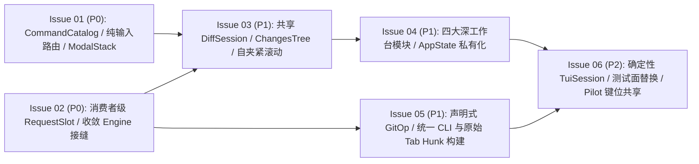

# Spec 11: 深模块架构治理、接缝收敛与确定性测试面重构规约

- **目录**：`.scratch/11-deep-module-architecture-hardening/`
- **下属 Issues**：
  - [`01-command-catalog-pure-input-and-modal-stack.md`](./issues/01-command-catalog-pure-input-and-modal-stack.md)（P0 · 统一 `CommandCatalog`、纯函数输入路由与自包含 `ModalStack` 模块）
  - [`02-consumer-scoped-request-slots-and-engine-seam.md`](./issues/02-consumer-scoped-request-slots-and-engine-seam.md)（P0 · 消费者级 `RequestSlot` 单飞取消与 `jbgit-engine` 窄接缝收敛）
  - [`03-shared-diff-changes-and-bounded-scroll-sessions.md`](./issues/03-shared-diff-changes-and-bounded-scroll-sessions.md)（P1，Blocked by `01, 02` · 跨工作台共享 `DiffSession`、`ChangesTreeSession` 与自夹紧滚动视口）
  - [`04-deep-workbench-modules-and-appstate-encapsulation.md`](./issues/04-deep-workbench-modules-and-appstate-encapsulation.md)（P1，Blocked by `01, 03` · 四大深工作台模块封装与 `AppState` 公开字段收敛）
  - [`05-unified-git-op-compiler-subprocess-and-hunk-builder.md`](./issues/05-unified-git-op-compiler-subprocess-and-hunk-builder.md)（P1，Blocked by `02` · 声明式 `GitOp`、统一 CLI 子进程接缝与保留原始 Tab 的 Hunk 构建器）
  - [`06-deterministic-tui-session-driver-and-pilot-codec.md`](./issues/06-deterministic-tui-session-driver-and-pilot-codec.md)（P2，Blocked by `04, 05` · 确定性 `TuiSession` 回合驱动、接口级测试替换与 `jbgit-pilot` 共享键位编解码）
- **关联源码**：
  - `Cargo.toml`、`tools/jbgit-pilot/Cargo.toml`、`tools/jbgit-pilot/src/{keys,server}.rs`
  - `crates/jbgit-core/src/{epoch.rs,stage_tracker.rs,details.rs}`、`crates/jbgit-core/src/git_ops/{mod,ops,outcome,rebase,refs}.rs`
  - `crates/jbgit-engine/src/{lib,supervisor,ops,cli,stage}.rs`、`crates/jbgit-engine/src/pool/{mod,worker_pool}.rs`、`crates/jbgit-engine/src/details/{mod,commit_changes,file_diff,file_history,path_matches}.rs`
  - `crates/jbgit-tui/src/{main.rs,app_git.rs,input_menus.rs,input_stage.rs,branches_popup.rs,dialogs.rs,stash_view.rs,syntax.rs,hit_test.rs}`
  - `crates/jbgit-tui/src/app/{mod,state,types,action,dispatch,effects,events}.rs`
  - `crates/jbgit-tui/src/app_stage/{mod,events,commit_flow,partial_diff}.rs`
  - `crates/jbgit-tui/src/keymap/{mod,actions,resolve,help}.rs`、`crates/jbgit-tui/src/input/{mod,keyboard,mouse,menus}.rs`、`crates/jbgit-tui/src/menus/{mod,log,branch,stage,stash}.rs`
  - `crates/jbgit-tui/src/log_view/{mod,details_pane,file_history,branches_pane,filter_bar,presentation}.rs`、`crates/jbgit-tui/src/stage_view/{mod,workbench,commit_editor}.rs`
  - `crates/jbgit-tui/src/views/{mod,footer,commit,commit_diff,file_history,stash,dialogs}.rs`、`crates/jbgit-tui/src/views/log_details/{mod,changes_browser,commit_details,diff_view}.rs`、`crates/jbgit-tui/src/views/overlays/{mod,context_menu,popups}.rs`
  - `crates/jbgit-tui/src/tests/{mod,runtime_and_editor_tests,footer_and_keymap_tests,file_history_and_changes_tests,context_menu_tests,branches_and_dialogs_tests}.rs`、`crates/jbgit-tui/src/log_tests.rs`

---

## 1. 背景与架构诊断

Commit `16a75c6` 将早期按里程碑演进累积的大文件按行数切分为数十个子文件，消除了单文件体积膨胀，但由于切分主要沿物理文件维度进行而未收缩模块接口（**Interface**），代码库中仍广泛存在**浅模块（Shallow Modules）**、**跨接缝泄漏（Seam Leakage）**以及**低局部性（Poor Locality）**。

在 `2026-11-22` 结合最近 60 次提交热点与全仓源码审计后，除定位到 6 组核心深化（Deepening）机会外，还直接暴露出 **7 处由调用方编排裂隙引发的真实缺陷与隐患**：

### 1.1 架构审计暴露的真实缺陷与不变量裂隙

1. **跨消费者共享 `EpochTracker` 导致兄弟视图 Diff 永久卡死（Cross-Consumer Cancellation Wedge）**：
   - `EpochTracker`（`crates/jbgit-core/src/epoch.rs:64-73`）为整个应用共享单一 `file_diff: RequestEpoch` 与 `commit_details: RequestEpoch`，而 `spawn_epoch_task`（`crates/jbgit-engine/src/supervisor.rs:270-287`）遇到 `Err(EngineError::Cancelled)` 时静默丢弃、不向 TUI 发送任何事件。
   - 当 `VCS Log` 发起 `request_file_diff(key_A)` 尚未返回时，若 `File History` 或 `Stash` 发起 `request_file_diff(key_B)`，后者会递增全局 `file_diff` 计数器将 `key_A` 标记为过期取消，而 `self.details.requested_diff`（`crates/jbgit-tui/src/app/dispatch.rs:923`）永远停留在 `Some(key_A)`，导致切回该文件时界面卡死在 `"Loading diff…"`。此外 `CommitDetailsLoaded`（`app/events.rs:125-137`）未做过期过滤，`AmendPreviewLoaded` 与 `ConflictDocumentLoaded` 完全缺失单飞令牌。
2. **`[diff] tab_size` 配置在真实仓库 Diff 上完全失效**：
   - `syntax.rs::render_diff_line_spans_with_tab`（`crates/jbgit-tui/src/syntax.rs:243-263`）本身通过了合成包含 `'\t'` 字符串的孤立测试（`syntax.rs:603`），但上游 `build_imara_hunks`（`crates/jbgit-engine/src/details/file_diff.rs:156`）、`SlicedDocument::display_text`（`crates/jbgit-core/src/stage_tracker.rs:121`）以及冲突回退渲染（`crates/jbgit-engine/src/stage.rs:465`）在构造 `DiffLine.text` 时全部提前硬编码执行了 `.replace('\t', "    ")`。`syntax.rs` 在生产环境中永远收不到 `'\t'`，用户在 `jbgit.toml` 中修改 `tab_size` 无任何效果。
3. **快捷键执行反向抓取本地化右键菜单助记符（Keymap-to-Menu Scraping）**：
   - `keymap/actions.rs` 中的 `find_action_by_mnemonic` / `branch_menu_action_by_mnemonic`（`crates/jbgit-tui/src/keymap/actions.rs:64-106, 502-509, 640-657`）在响应 `Checkout`、`Uncommit`、`Reword`、`DropCommit`、`RenameBranch`、`DeleteBranch` 等快捷键时，临时构造整棵带 i18n 文案的 `Vec<ContextMenuItem>` 并按单字母 `mnemonic == 'c' | 'u' | 'w' | 'x' | 'e' | 'd'` 反向扫描提取 `Action`。一旦调整菜单文案助记符或启用状态，键盘快捷键即静默失效。
4. **输入路由函数伪装纯函数却就地篡改 `&mut AppState`**：
   - `route_terminal_event`（`crates/jbgit-tui/src/input/mod.rs:14`）返回 `Vec<Action>`，但在 `route_paste`（`input/mod.rs:30-114`）、`route_modal_key` / `route_shortcuts_help_key` / `route_file_history_key`（`input/keyboard.rs:97-218, 385-394, 575`）、`route_branches_popup_key`（`branches_popup.rs:346-355`）、`route_stage_left_click`（`input_stage.rs:233, 244-255`）及 `context_menu_for_target`（`input_menus.rs:604-607, 674, 699, 715`）等约 15 处直接写入 `AppState` 字段，甚至出现「既直接改状态又再发 `Action::Select*`」与 `flush_menu_hover`（`input_menus.rs:285`）内部调 `let _ = state.dispatch(...)` 丢弃返回 `Effect` 的问题。
5. **滚动夹紧依赖上一帧渲染回写，遗漏三方冲突视图与提交编辑器**：
   - `ViewportScrollMetrics`（`app/types.rs:38-92`、`app/state.rs:293-360`）要求每个可滚动面板手动在 `ScrollPane` 与渲染尾部两处登记；`ConflictScroll`（`crates/jbgit-tui/src/app_git.rs:285`）被遗漏（`cm.scroll = (cm.scroll as isize + delta).max(0) as usize`，无上界夹紧，重现触底后反向滚动死区），而 `CommitMessageEditor::scroll_row`（`stage_view/commit_editor.rs:24`）在 `views/commit.rs:683-689` 被读取却在全仓从未被写入。
6. **`AppState`（54 个 `pub` 字段）与 `StageWorkbenchState`（41 个 `pub` 字段）时序不变量外泄**：
   - `commit_stage_selected_idx` 放在 `AppState`（`app/state.rs:75`），而 `rows` 放在 `StageWorkbenchState`（`stage_view/workbench.rs:97`），迫使 `app_stage/mod.rs` 手动调用 11 次 `sync_rows`，而 `keymap/actions.rs:617, 679`、`input_stage.rs:128` 与 `views/footer.rs:591` 直接读取未同步的 `rows`；`dispatch_log_action`（`app/dispatch.rs:564-680`）重复手写 13 遍 `self.details.compare_override = None; self.details.pending_select_path = None;`。
7. **`GitOp` CLI 编译跨 Crate 割裂与 `RunCli` 旁路**：
   - `GitOp::simple_steps`（`crates/jbgit-core/src/git_ops/ops.rs:379-627`）在 `CheckoutPaths` 超过 32 个路径时返回 `None` 交由 `jbgit-engine/src/ops.rs:209-219` 走 `prepare_pathspec_args`，但 `AcceptSide`、`IntentToAdd`、`StashPush` 未走 `--pathspec-from-file`；`PatchToClipboard { args: Vec<String> }` 让 TUI 菜单直接拼原生 `git diff` 参数；`StashAll`（`app_stage/mod.rs:266`）与提交后 `push`（`app_stage/events.rs:249`）绕过 `GitOp` 直发 `Effect::RunCli`，丢失 `PushRejected` 等语义化错误恢复弹窗；`run_git_op` 与 `spawn_execute_commit` 静默忽略了 `index_lock_conflict`。

---

## 2. 设计原则与词汇约定

本规约统一采用深模块设计（Deep Module Design）术语：
- **模块（Module）** 与 **接口（Interface）**：接口不仅包含类型与函数名，还包含调用方必须遵守的所有前置条件、调用顺序与缓存同步不变量。目标是**缩窄接口、加深实现（Depth）**，为调用方提供高**杠杆（Leverage）**，为维护者集中**局部性（Locality）**。
- **接缝（Seam）** 与 **适配器（Adapter）**：仅在确实存在至少两个适配器（如生产环境子进程/终端 vs 测试环境确定性替身）的位置设立外部接缝；单实现透传直接内聚隐藏，满足**删除测试（Deletion Test）**。
- **测试面即接口（Replace, Don't Layer）**：新测试统一穿过加深后的模块接口断言可观测结果，删除原先直接篡改内部缓存字段或手写残缺事件循环的脆弱测试。

### 非目标（Out of Scope）
- **不改变既有产品功能、快捷键默认行为与视觉表现**（除修复上述已确认的 `[diff] tab_size` 失效、跨视图 Diff 取消卡死、`ConflictScroll` 越界与提交编辑器滚动跟随缺陷外）。
- **不回退 Spec 10 已落地的任何性能优化指标**（异步高亮、4 MiB/2048 B 安全护栏、`O(tree_depth)` Diff 快路径、双优先级线程池、64 条事件批处理合并、矢量图局部重绘缓存均须完整保留）。
- **不破坏混合 Git 引擎架构原则**（`git2` 多线程只读查询 + 内存 Index 局部暂存；原生 `git` CLI 执行写操作与远端同步并维持 `GIT_OPTIONAL_LOCKS=0` / `GIT_TERMINAL_PROMPT=0`）。

---

## 3. 核心架构深化方案

### 3.1 统一 `CommandCatalog`、纯函数输入路由与自包含 `ModalStack`（Issue 01）
- 将 `menus/stash.rs` 已验证的声明式 `StashActionSpec` 推广为单一深模块 **`CommandCatalog`**：统一定义每个命令的 `KeyAction`、生效作用域与上下文谓词、`Result<(), DisabledReason>` 可用性判定、基于 `resolve_key_in_scopes` 的遮蔽感知快捷键查询、底栏/帮助面板元数据及 `(&AppState) -> Vec<Action>` 动作解析。
- 删除 `ContextMenuAction`、`find_action_by_mnemonic`、`ModalLayer::CriticalDialog`，合并 `input/menus.rs` 与 `input_menus.rs`；键盘、鼠标工具栏、右键菜单、Footer 提示与 `?` 帮助面板共享同一命令目录。
- 将 `route_terminal_event(event: &Event, state: &AppState) -> Vec<Action>` 改造为严格只读纯函数，彻底清零路由期对 `AppState` 的就地可变修改。
- 构建自包含 **`ModalStack`** 模块：将挂在 `AppState` 顶层的弹窗旁路字段（`file_history`、`conflict_merge`、`hook_error_output`、三方 Hunk 检视索引等）内聚进强类型模态变体，使入栈/出栈天然完成状态清理。

### 3.2 消费者级 `RequestSlot` 单飞取消与 `jbgit-engine` 窄接缝（Issue 02）
- 用按**消费者槽位（Consumer Slot）**隔离的 **`RequestSlot<K>`** 模块取代全局按请求类型共享的 `EpochTracker`、`AppState` 上的 7 个 `latest_*_epoch` 字段以及 `SyntaxJobSlot<K>`：
  - `LogDiff`、`StashDiff`、`FileHistoryDiff`、`StageDiff`、`LogDetails`、`StashDetails` 等各自独立维护单飞令牌与 `in_flight` 键，兄弟视图互不误杀请求，且被新请求取代时自动推进本槽位期待键，根治 `"Loading diff…"` 卡死；补齐 `CommitDetails`、`AmendPreview`、`ConflictDocument` 的过期过滤。
- 收敛 `jbgit-engine` 对外接口：将 `Git2WorkerPool` 的 18 个透传方法及 `lib.rs` 暴露的 20+ 个内部 `*_sync` 函数降为 `pub(crate)`，对外仅暴露窄接缝（`EngineSupervisor` / `EngineBackend` + `TaskRequest` + `EngineEvent`），并提供确定性内存/本地替身适配器消除测试中的 `sleep`。

### 3.3 共享 `DiffSession`、`ChangesTreeSession` 与自夹紧滚动视口（Issue 03）
- 提取全局唯一的 **`DiffCacheStore`**（统一承载 `CommitChangesBundle`、`FileDiff` 与 `HighlightedDiff` LRU），删除 `StashTabState` 内嵌克隆的第二份 `DetailsPaneState` 及双写同步逻辑。
- 构建深模块 **`DiffSession`** 与 **`ChangesTreeSession`**：统一承载 `Unified` / `Split` 行投影缓存、按需 `LazyWordDiffCache`、Hunk 跳转、30ms 防抖请求槽位与统一/双栏渲染（通过窄适配器挂钩支持 `Staging Workbench` 的 1 列行状态槽与 Hunk 操作胶囊），消除 4 套重复的 Diff 状态机与 20+ 个按宿主重复命名的 `Action` 变体。
- 用自夹紧 **`ScrollViewport`** 替代跨帧拼装的 6 分支 `ViewportScrollMetrics`，统一覆盖 `VCS Log`、`Stash`、`File History`、`Staging`、`Git Console`、**`3-Way Conflict Resolver`**（修复 `ConflictScroll` 无上界死区）及 **`CommitMessageEditor`**（修复 `scroll_row` 光标跟随）。

### 3.4 四大深工作台模块与 `AppState` 私有化收敛（Issue 04）
- 将散落在 8 个文件中的 `impl AppState` 碎片与 95+ 个公开字段收敛为四个拥有窄接口（`dispatch`、`on_event`、`next_deadline`、只读视图访问器）与私有不变量的深模块：**`CommitWorkbench`**、**`LogWorkbench`**、**`StashWorkbench`**、**`ConsoleWorkbench`**。
- `CommitWorkbench` 内部共同持有选中行索引与私有 `rows` 缓存（状态或树选项变更时自动标记脏并在访问器内透明同步，删除 11 处散落手动 `sync_rows` 调用）；`LogWorkbench` 将提交导航副作用（清理 `compare_override` / `pending_select_path`）收敛到单一内部出口（删除 13 处重复重置块），并合并 `LogPresentation`、`compact_refs`、`show_tag_names`；焦点切换统一在一个入口自动收敛各面板行内编辑态。

### 3.5 声明式 `GitOp`、统一 CLI 子进程接缝与保留原始 Tab 的 Hunk 构建器（Issue 05）
- 保持 `jbgit-core::GitOp` 为零 CLI 细节的纯声明式领域意图：用类型化 `PatchSpec` 替换 `PatchToClipboard { args: Vec<String> }`，并将 TUI `StashAll` 与提交后 `Push` 统一纳入 `GitOp`，使所有写操作共享 `GitOpOutcome` 错误语义分级。
- 将 `GitOp::simple_steps` 迁入 `jbgit-engine/src/ops.rs`，构建单一深模块处理全部命令参数编译、通用 `prepare_pathspec_args`（覆盖 `CheckoutPaths`、`AcceptSide`、`IntentToAdd`、`StashPush`）、统一 `git` 可执行文件探测与非交互环境隔离（合并 `cli.rs` 与 `details/mod.rs` 重复代码）以及一致的 `index.lock` 冲突检测，并在进程接缝处提供生产子进程与测试录制回放两个适配器。
- 统一 `jbgit-core` / `jbgit-engine` 的双文档与三文档 Hunk 构建及 4 MiB 体积/8 KiB 二进制守卫读取器，**移除 `DiffLine.text` 构造阶段的 `.replace('\t', "    ")`**，让 `syntax.rs` 成为唯一按配置 `tab_size` 展开制表符的渲染出口。

### 3.6 确定性 `TuiSession` 回合驱动与 `jbgit-pilot` 共享键位编解码（Issue 06）
- 为 `jbgit-tui` 提供库目标（`lib.rs`）并提取深模块 **`TuiSession`**：完整封装单回合确定性步进（`ingest_events` → 纯 `route_terminal_event` → `dispatch` → `coalesce_effects` → `execute_effects` + 虚拟时钟 `advance_to(Instant)`），使 `main.rs` 退化为 ~80 行薄终端 I/O 启动壳。
- 遵循 **Replace, Don't Layer**：用穿过 `TuiSession` 真实接口的确定性测试替换 6 个测试文件中手写的残缺 `route -> dispatch` 循环及直接写内部缓存字段的脆弱测试。
- 将 `tools/jbgit-pilot` 纳入 Workspace（或共享键位编解码模块），消除第二套独立按键解析器，并将 `jbgit-pilot` 剪贴板读取改为增量偏移扫描。

---

## 4. 任务拆分与依赖顺序

1. **Issue 01**（P0，无前置阻塞）与 **Issue 02**（P0，无前置阻塞）分别治理 `jbgit-tui` 命令/输入/模态入口与 `jbgit-core`/`jbgit-engine` 异步单飞接缝，文件集正交，可并行推进。
2. **Issue 03**（P1，`Blocked by: 01, 02`）与 **Issue 05**（P1，`Blocked by: 02`）分别在 TUI 层收敛跨工作台 Diff/文件树/滚动会话，以及在 Core/Engine 层收敛 `GitOp` 编译、子进程接缝与原始 Tab Hunk 构建器，二者同样正交可并行推进。
3. **Issue 04**（P1，`Blocked by: 01, 03`）在命令目录与共享 Diff 会话就绪后，将 `AppState` 收缩为薄协调器并完成四大深工作台模块私有化封装。
4. **Issue 06**（P2，`Blocked by: 04, 05`）提取确定性 `TuiSession` 回合驱动、打通 `jbgit-pilot` 共享键位编解码，并完成全套接口级测试替换收官。

---

## 5. 验证与回归策略

1. **静态检查与全量测试门禁**：
   - 每个 Issue 交付时必须通过 `cargo test --workspace`（Issue 06 起包含 `jbgit-pilot`）与 `cargo clippy --workspace --all-targets -- -D warnings`。
2. **已识别缺陷的确定性回归测试**：
   - 跨消费者并发请求（`VCS Log` 与 `File History` / `Stash` 交错加载 `FileDiff` / `CommitDetails`）永不卡死在 `"Loading diff…"`；
   - 含真实 `'\t'` 缩进文件的两文档与三文档 Diff 在 `tab_size = 2` / `4` / `8` 下精确渲染对应列宽；
   - 修改任意右键菜单助记符或切换 `zh-CN` / `en-US` 语言绝不影响键盘快捷键派发；
   - `3-Way Conflict Resolver` 触底滚动后按单次 `Up` 立即上移一行无死区，`CommitMessageEditor` 多行输入越过视口高度自动跟随光标。
3. **性能与交互零退化校验**：
   - 运行 `cargo bench -p jbgit-core` 及 `jbgit-pilot` 沙箱冒烟流程（Log / Commit 局部暂存 / Branches Popup / File History / Conflict Merge），确认帧耗时、切换延迟与键鼠交互零退化。
