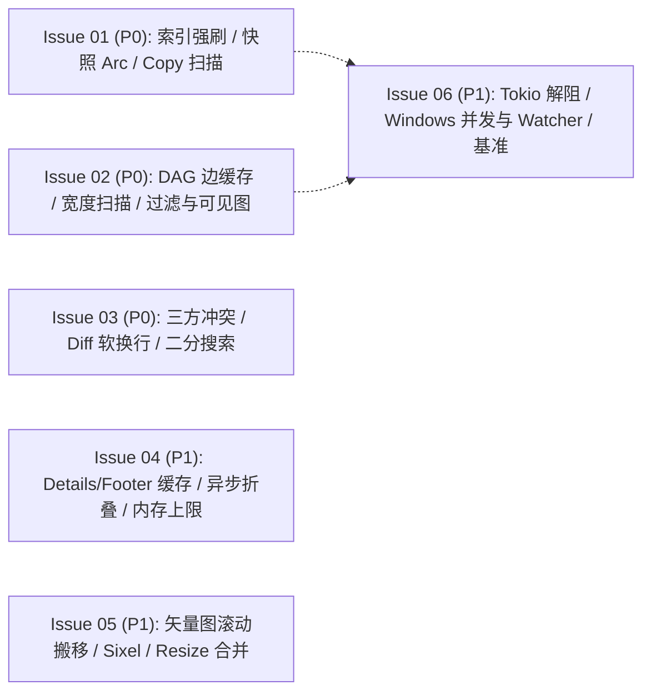

# Spec 16: 大仓库、渲染热路径与引擎并发性能二期治理（Phase 11）

> **2026-11-28 范围修订**：评估后只实施实测或明确有收益的子集，见 [§5 范围修订](#5-范围修订2026-11-28)。§1–§4 为原始审计记录，各 Issue 文首「范围修订」节为当前需求。

- **目录**：`.scratch/16-large-repo-and-ui-performance-hardening/`
- **状态**：`01`、`02`、`03`、`05`、`06` resolved（后四项为收窄范围）；`04` wontfix；`07` needs-triage（暂缓候选项）。分支 `spec16-perf`，Commits `1f8c349`..`9e76d21`。
- **下属 Issues**（按 P0 严重阻塞 → P1 高频交互掉帧 / 异步阻塞 / 内存与基准补齐，拆分为 6 个正交原子工单，另加范围修订后的 1 个暂缓汇总工单）：
  - [`01-engine-index-reload-snapshot-arc-and-copy-scan.md`](./issues/01-engine-index-reload-snapshot-arc-and-copy-scan.md)（**P0** · 消除 `with_thread_repo` 强刷 `.git/index`、`SnapshotCommitCache` 三份深拷贝与点击 Untracked 文件全仓拷贝扫描）
  - [`02-core-dag-edges-filter-and-visible-graph-perf.md`](./issues/02-core-dag-edges-filter-and-visible-graph-perf.md)（**P0** · 删除冗余 `edges_from_below`、重写 `recommended_track_width` 线性扫、优化 `VisibleGraph` 小 Vec 分配与零分配 OID / Filter 匹配）
  - [`03-conflict-merge-and-diff-soft-wrap-search-perf.md`](./issues/03-conflict-merge-and-diff-soft-wrap-search-perf.md)（**P0** · 修复三方冲突每帧三倍克隆与 `Custom` `O(L²)` 爆炸、缓存 Diff 软换行前缀和、`ranges_for` 二分与滚动惰性 fallback）
  - [`04-tui-frame-caching-ui-thread-offload-and-memory-bounds.md`](./issues/04-tui-frame-caching-ui-thread-offload-and-memory-bounds.md)（**P1** · Commit Details/Footer/Filter 弹窗缓存与 UI 线程零 I/O、异步折叠构图、`ConsoleWorkbench` 与 `rollback_undo_stack` 内存有界化）
  - [`05-vector-graph-scroll-blit-and-resize-coalescing.md`](./issues/05-vector-graph-scroll-blit-and-resize-coalescing.md)（**P1** · 矢量图垂直滚动 `copy_within` 行级搬移、命中区按 `content_key` 缓存、Sixel 量化加速与 `Resize` 事件合并）
  - [`06-engine-tokio-unblock-windows-scaling-and-benchmarks.md`](./issues/06-engine-tokio-unblock-windows-scaling-and-benchmarks.md)（**P1** · 移除 Tokio 异步线程阻塞、Windows 大工作区/串行子进程与 Watcher 治理、补齐 Criterion 回归基准）
  - [`07-deferred-perf-candidates.md`](./issues/07-deferred-perf-candidates.md)（**P2** · 范围修订后暂缓的特定场景候选项与 `recurse_untracked_dirs` 产品决策，待评估）
- **关联源码**：
  - `crates/jbgit-core/src/`：`oid.rs`、`filter.rs`、`repo.rs`、`conflict.rs`、`details.rs`、`stage.rs`、`stage_tracker.rs`、`branch_tree.rs`、`refs.rs`、`graph/{edges_in_row.rs, print_elements.rs, visible.rs, permanent.rs, linear_bek.rs, joiner.rs}`
  - `crates/jbgit-core/benches/graph_layout.rs`
  - `crates/jbgit-engine/src/`：`supervisor.rs`、`cli.rs`、`ops.rs`、`stage.rs`、`watcher.rs`、`pool/{worker_pool.rs, snapshot.rs, stage_status.rs, scan_config.rs}`、`details/{mod.rs, commit_changes.rs, file_diff.rs, tree.rs, blame.rs, outgoing.rs, remote_tag.rs}`
  - `crates/jbgit-tui/src/`：`session.rs`、`diff_session.rs`、`syntax.rs`、`console_workbench.rs`、`app/{state.rs, scroll.rs, events.rs, dispatch.rs}`、`log_view/{workbench.rs, filter_bar.rs, branches_pane.rs}`、`stage_view/workbench.rs`、`graph/{state.rs, renderer.rs, vector/mod.rs, vector/encode.rs}`、`views/{log.rs, footer.rs, console.rs, annotate.rs, file_history.rs, commit_diff.rs, conflict_merge.rs, overlays/popups.rs, log_details/commit_details.rs, log_details/diff_view.rs}`

---

## 1. 背景与问题诊断

Spec 10（`#10`）解决了早期语法高亮阻塞 UI、主循环事件合并等主要矛盾；随后 Spec 12–15 陆续引入了**增量日志刷新与分页、真正 3-Way 合并与冲突队列、Diff 软换行与 `/` 搜索、Blame Annotate、LinearBek 图谱折叠、Update Project** 等重要特性。

`2026-11-28` 对 `jbgit-core`、`jbgit-engine`、`jbgit-tui` 三个 Crate 开展二期全量源码性能审计，确认当前版本在**中小型仓库（< 2,000 commits / < 1,000 文件）**下空闲 CPU 接近 0%、交互流畅；但在**中大型仓库（5 万–20 万 commits、1 万–5 万文件，尤其是 Windows 平台）**、**大 Diff 软换行/搜索**、**大文件三方冲突**、**Kitty/Sixel/iTerm2 矢量图滚动与缩放**以及**长会话高输出场景**下，仍存在一批明确的算法与并发瓶颈：

### 1.1 核心瓶颈全景汇总

| 级别 | 模块 / 路径 | 瓶颈机制 | 典型触发阈值与影响 | 归属 Issue |
| :---: | :--- | :--- | :--- | :---: |
| **P0** | `pool/worker_pool.rs:79-89` | `with_thread_repo` 无条件执行 `index.read(true)`（绕过 stat 检查强刷重解析 `.git/index`），连只读 ODB/revwalk/diff 任务也执行 | 万级文件仓库每次点选/diff/刷新多耗时 **5–50+ ms** | **01** |
| **P0** | `supervisor.rs:1354-1361`、`snapshot.rs:533-542, 964-970`、`joiner.rs:140-163, 193-208` | 在 Tokio 异步线程持锁深拷贝 5 万–20 万 `CommitSummary`（5 个堆字段），`IncrementalNoOp` 亦多层克隆，三份拷贝并存；`joiner.rs` 构建未使用 `existing_in_prefix` 且 `insert_indexed` 为 `O(K²)` | 5万–20万 commits 每次刷新阻塞 Tokio **50–300+ ms**，瞬时 RSS 尖峰 **100–400+ MB** | **01** |
| **P0** | `stage.rs:492-535, 609-629`、`stage_status.rs:17-53, 222-235` | 点击任意 Untracked 文件（`!in_head`）在唯一 Interactive 线程跑全仓 `diff_tree_to_index` + `copies_from_unmodified(true)`；暂存任意 `Added` 文件同样全仓扫描（阈值高达 2 万） | 5千–2万文件仓库点击未跟踪文件卡顿 **数百 ms 至数秒** | **01** |
| **P0** | `edges_in_row.rs:117-236`、`print_elements.rs:419-459` | `edges_from_below` 与 `edges_from_above` 在数学上 **100% 冗余**，双倍缓存与克隆；`ultra_long_edges` 全线性扫描；`recommended_track_width`（`n >= 40k`）触发 4 万次查询打穿 20 块 LRU 并挤出首屏缓存 | 4万–20万 commits 构图/筛选/切换折叠卡顿 **百 ms 至数秒** | **02** |
| **P0** | `visible.rs:259-567`、`oid.rs:38-47`、`filter.rs:840-868` | `build_visible_linear` 每次分配 40万–60万个小 `Vec`；`Oid::matches_hex_prefix` 每次分配 40B `String`；`LogFilterSpec` 先跑昂贵文本/正则再跑 `O(1)` 日期/路径/范围判断 | 5万–20万 commits 筛选输入每次击键数万至数十万次堆分配 | **02** |
| **P0** | `conflict.rs:1053-1183`、`conflict_merge.rs:424`、`app/state.rs:461` | `three_pane_rows()` 每帧与每次滚动全文件 3 倍克隆所有行；`choice: Some(b.choice.clone())` 在 `Custom(Vec<String>)` 下导致 **`O(L²)`** 克隆；无 `MAX_DIFF_FILE_BYTES` 守卫 | 5千–5万行冲突文件或千行自定义编辑每帧卡顿 **10–100+ ms**（百万次分配） | **03** |
| **P0** | `diff_view.rs:1003-1017`、`commit_diff.rs:651-665`、`diff_session.rs:748-763, 877-909`、`app/state.rs:410-438` | 软换行每帧全量 `O(N)` Unicode 折行测高；滚动路径提前算被 `scroll_by` 丢弃的 `fallback` 造成 2–3× 扫描；`DiffSearchState::ranges_for` 线性扫描已排序 `matches`；`ModalPaste` 逐字符全量重搜 | 5千–2万行 Diff 软换行/搜索滚动 **10–50+ ms/帧** | **03** |
| **P1** | `commit_details.rs:125-130, 485-549`、`footer.rs:317-336, 785-825`、`filter_bar.rs:233-275, 428-493`、`graph/state.rs:1078-1092, 1304-1409`、`console.rs:255-336` | Details 每帧扫全文 SHA 并调用全量线性 `resolve_revision`；Footer 每帧重算且溢出循环 `O(P²)` `format!`；Filter 弹窗 `Paths` 每帧同步 `read_dir`；折叠/SpeedSearch 在 UI 线程同步全图重算；Console 渲染构建全部 `O(N)` 行、命令列表与 `rollback_undo_stack` 无界 | 高频交互掉帧、大日志/多次回滚内存持续膨胀 | **04** |
| **P1** | `vector/mod.rs:414-582`、`vector/encode.rs:177-321`、`session.rs:520-531`、`renderer.rs:337-341` | 按屏幕行号缓存导致滚 1 行 100% 失效率全条带重绘 + UI 线程同步 PNG/Sixel 编码；`register_hits` 每帧重算几何并推送上千个 1-cell 区域；Sixel 量化 `O((K-256)×256)` 最近邻；`Resize` 不合并且无条件 `invalidate()` | HiDPI 下矢量图滚动与窗口拖拽缩放掉帧明显 | **05** |
| **P1** | `stage.rs:2307`、`ops.rs:1774, 2321-2596`、`commit_changes.rs:512-543`、`watcher.rs:168-208, 350-435`、`cli.rs:245-315`、`graph_layout.rs` | `execute_commit_cli_async`/`plan_accept_side`/`require_git_executable` 阻塞 Tokio 线程；`UpdateProject`/CRLF/多选签名串行 spawn `git.exe`；`load_commit_details_sync` 独占唯一 Interactive 线程算全量 Histogram diff；Watcher 递归监听 `.git/` 与 `target/`/`node_modules/` 且仅缓存直接父目录；`graph_layout.rs` 基准覆盖存在盲区 | Windows 大工作区卡死、Tokio 饥饿、Interactive 队头阻塞、无长边/真实结构基准护航 | **06** |

### 1.2 已有架构优势（治理中须完整保留）

- **零轮询事件循环**：`tokio::select!` + 按需 `needs_redraw` + 最多 64 事件批合并 + 鼠标移动快速路径。
- **消费者级单飞取消**：34 个独立 `RequestSlotId` 与 `EpochToken`、`Git2WorkerPool` 优先级隔离、`WindowsJobGuard` 进程树清理。
- **跨工作台共享缓存与安全阀**：`DiffCacheStore` LRU、`4 MiB / 20k 行` diff 护栏、`MAX_SYNTAX_LINE_BYTES = 2048` 后台可取消高亮、超过 2,000 commits 异步构图。

---

## 2. 设计目标、量化指标与非目标（Out of Scope）

### 2.1 核心目标与量化指标

1. **交互响应与大仓基线（5万–20万 commits / 1万–5万文件）**：
   - 只读查询不再强刷 `.git/index`；Stage 视图点击 Untracked 文件 **< 20 ms**（彻底消除全仓 `copies_from_unmodified` 误触发）。
   - 快照增量刷新（含 `IncrementalNoOp`）在 Tokio 线程零大型 `Vec<CommitSummary>` 深拷贝，内存尖峰降低 **> 65%**。
   - `EdgesInRowGenerator` 内存与命中克隆开销减半；`recommended_track_width` 单趟线性扫描（不驱逐首屏缓存）；`Oid::matches_hex_prefix` 零堆分配。
2. **每帧渲染与滚动流畅度**：
   - `ConflictMerge`（5k+ 行 / `Custom` 千行块）、软换行 `Diff`（5k–20k 行）与 `CommitDetails` 在滚动与悬停期间单帧耗时 **< 4–8 ms**，消除 `O(L²)` / `O(Tokens × Commits)` / `O(H × M)` 热路径。
   - 矢量图滚动通过 `copy_within` 仅栅格化新增行，Sixel 量化与 `Resize` 合并消除拖拽缩放卡顿。
3. **异步卫生与内存有界**：
   - Tokio 异步工作线程零同步 `git2::Repository::open` / `with_thread_repo` / `std::fs` 大读写 / `git --version` 探测。
   - `ConsoleWorkbench::entries`（命令条数）与 `rollback_undo_stack`（条数 + 总字节数）受明确上界约束。

### 2.2 非目标（Out of Scope）

- **不引入 SQLite 持久化索引**：沿用 Spec 13 拍板 `wontfix` 决策，继续基于内存 CSR 图 + 轻量增量 Join + 分页模型优化。
- **不替换 `syntect` 语法高亮引擎**：保留现有异步可取消 `syntect` 管线。
- **不破坏混合 Git 引擎读写边界**：保持 `git2` 只读/内存局部暂存 + 原生 `git` CLI 写操作（只读 CLI 强制 `GIT_OPTIONAL_LOCKS=0`、`GIT_TERMINAL_PROMPT=0`）。
- **不对常规 Console 单条命令输出行设硬截断**：沿用 `#07` / `#08` 架构取舍（见 `.scratch/README.md:253`），`GitConsoleEntry::output_lines` 继续完整保留正常命令审计行，仅通过视口虚拟化（`O(H)` 渲染）、限制保留的命令历史条数（`VecDeque`）与解耦大体积 Patch 导出流（`CreatePatchFile` / `PatchToClipboard`）避免通道与内存失控。

---

## 3. 任务拆分与执行批次

六个工单代码面正交（`Issue 06` 的 Criterion 基准扩展可与 `01`/`02` 的改动协同验证，其余均可并行推进）：

- **Batch 1（P0 核心卡顿与算法/内存缺陷消除）**：`01`、`02`、`03`
- **Batch 2（P1 每帧渲染优化、矢量图、Tokio/Windows 与基准防线）**：`04`、`05`、`06`

---

## 4. 验收与回归基准总则

1. 每个 Issue 均须配套**针对性单元测试或 Criterion 基准**（在修复前可复现对应复杂度/冗余分配/同步阻塞缺陷，修复后验证等价性与复杂度收敛）。
2. 全仓门禁在每个 Issue 合并前须全量通过：
   - `cargo fmt --all -- --check`
   - `cargo clippy --workspace --all-targets -- -D warnings`
   - `cargo test --workspace --locked`
3. 基准编译验证：`cargo bench -p jbgit-core --no-run`（并在改动核心算法后实跑相关基准对比前后耗时）。

---

## 5. 范围修订（2026-11-28）

### 5.1 修订原因

§1 中多数耗时为审计估算而非实测。完成 `01` 后实跑 10 万提交基准（`graph_layout`）得到：

| 基准 | 耗时 |
| :--- | ---: |
| `recommended_track_width_100k`（每次构图 / 筛选 / 折叠） | ≈ 190 ms |
| 构图（`permanent_graph_and_dfs_layout_100k` + `visible_graph_build_*`） | ≈ 21 ms + 15 ms |
| `print_elements_viewport_60_rows_100k`（每帧） | ≈ 0.36 ms |
| `incremental_head_join_100k_2000_new_commits` | 8.2 ms → 7.3 ms（`01` 后） |

即「每帧渲染很慢」类结论大多不成立，真正的大头是少数算法热点与特定场景 bug。因此只保留**真实卡顿或 bug、且改动小**的条目，其余按「暂缓（移入 `07`）」或「不做」处理。

### 5.2 本轮实施（分支 `spec16-perf`）

| Issue | 状态 | 实施内容 | Commit |
| :---: | :---: | :--- | :---: |
| `01` | resolved | `index.read(false)` 替代强刷；`RepoSnapshot::commits` 改 `Arc` 共享；`insert_indexed` 去 `O(K²)`；未跟踪文件跳过全仓 copy 扫描 | `0d94bee` |
| `02` | resolved（收窄） | `recommended_track_width` 单趟差分扫描：189.6 ms → 0.35 ms | `a4b0cc6` |
| `03` | resolved（收窄） | 冲突 `Custom` `O(L²)` 克隆、视口窗口投影与廉价总行数；惰性滚动 fallback；`ranges_for` 二分；模态粘贴单次重算；4 MiB 护栏回归测试 | `013495f` |
| `04` | wontfix | 本轮不做（候选项移入 `07`） | — |
| `05` | resolved（收窄） | `set_capabilities` 能力未变不作废；连续 `Resize` 合并 | `042aa3b` |
| `06` | resolved（收窄） | Watcher 早期路径过滤 + 祖先目录忽略缓存 + `\\?\` / 盘符归一化；Added/Deleted 文件直接计行；`CompareWithLocal` 大索引护栏 | `9e76d21` |
| `07` | needs-triage | 暂缓候选项汇总 | — |

公共 API 变化：`RepoSnapshot::commits: Arc<Vec<CommitSummary>>`；`ConflictPaneRow::choice: Option<ConflictChoiceKind>`。

### 5.3 不做的条目（不再跟踪）

- `02`：`edges_from_below` 去重、`VisibleGraph` / `PermanentGraph` / `LinearBek` 分配瘦身、`Oid` / Filter / `glob` / `FuzzyMatcher` / `natural_cmp` / `repo.rs` 微优化——每帧 0.36 ms、构图约 35 ms，用户无感。
- `03`：`-b` / `-w` 拷贝、`paired_line_in_hunk` 缓存、Annotate / FileHistory 行偏移缓存、`Unchanged` 三倍克隆。
- `04`：Footer、`has_multi_selection` 等常数级开销；异步折叠构图（主要耗时已由 `02` 消除）；`rollback_undo_stack` 上限与零散同步 I/O / 空转重绘。
- `05`：`copy_within` 滚动搬移、命中区缓存、Sixel 量化——仅矢量图模式受益，若后续默认启用矢量后端再评估。
- `06`：Tokio 去阻塞、`git --version` 双探测、批量验签、取消链路与 `WindowsJobGuard`、CLI 静默缓冲、blame porcelain、Criterion 基准补齐。

### 5.4 验收门禁调整

- 每个 Issue 只跑受影响 crate 的 `cargo test -p` / `cargo clippy -p`；全量 `cargo clippy --workspace --all-targets -- -D warnings` 与 `cargo test --workspace --locked` 在全部完成后统一跑一次（2026-11-28 通过）。
- 仓库未做 rustfmt 全量清理，不执行 `cargo fmt --all -- --check`；只对改动行按 rustfmt 风格手工格式化。
